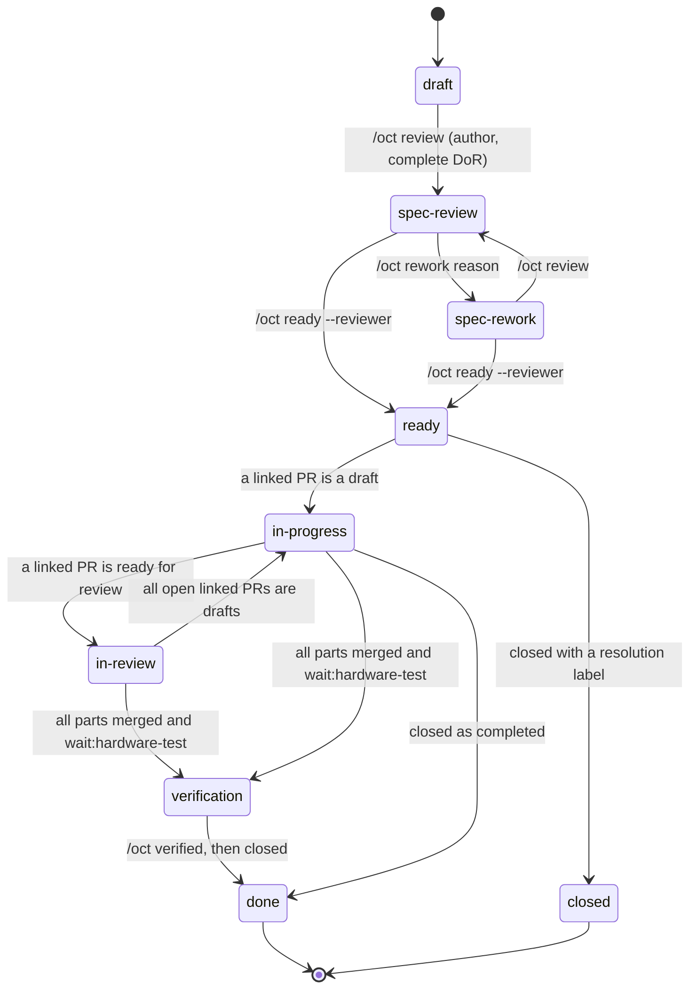
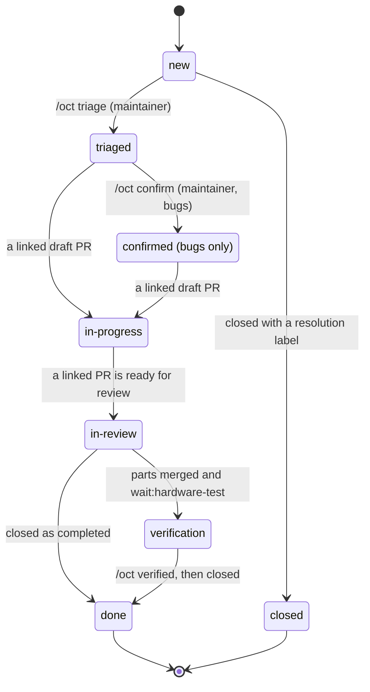
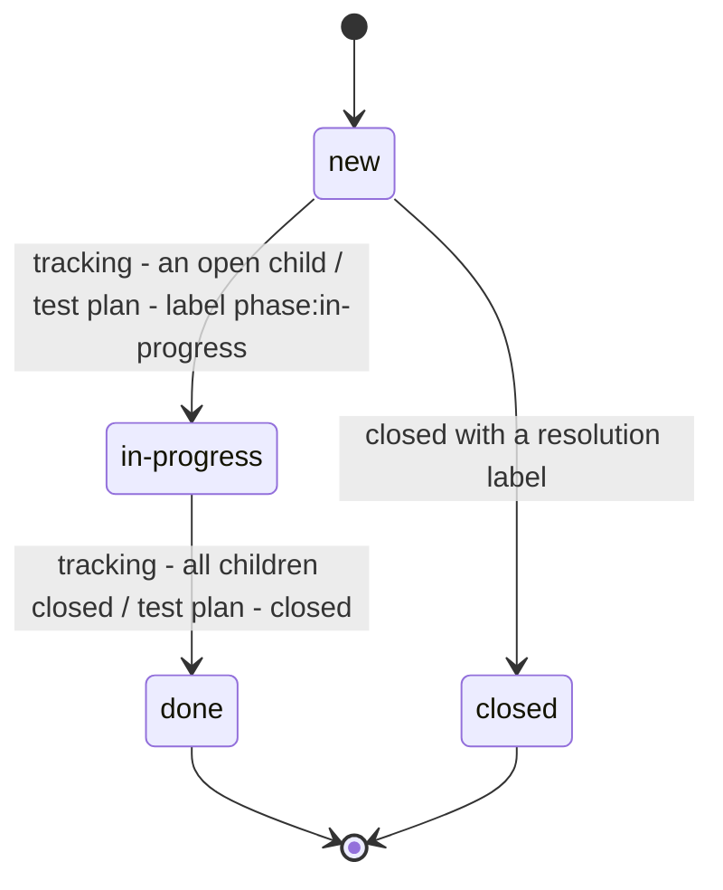
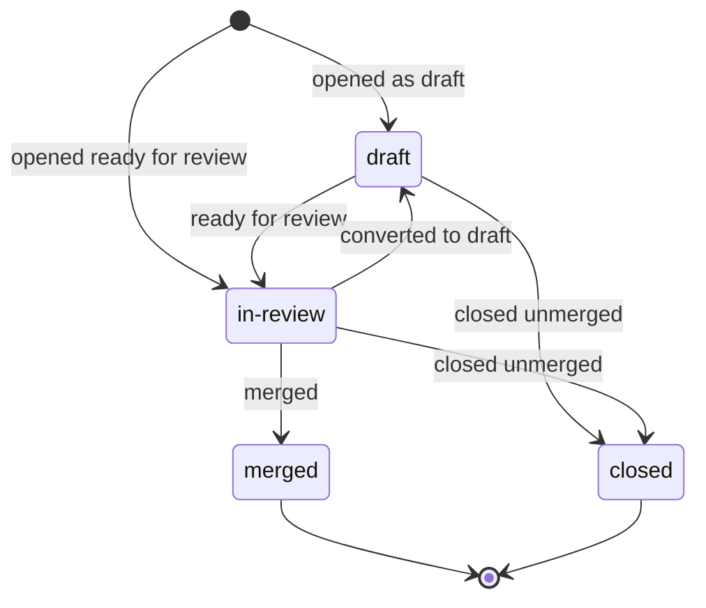
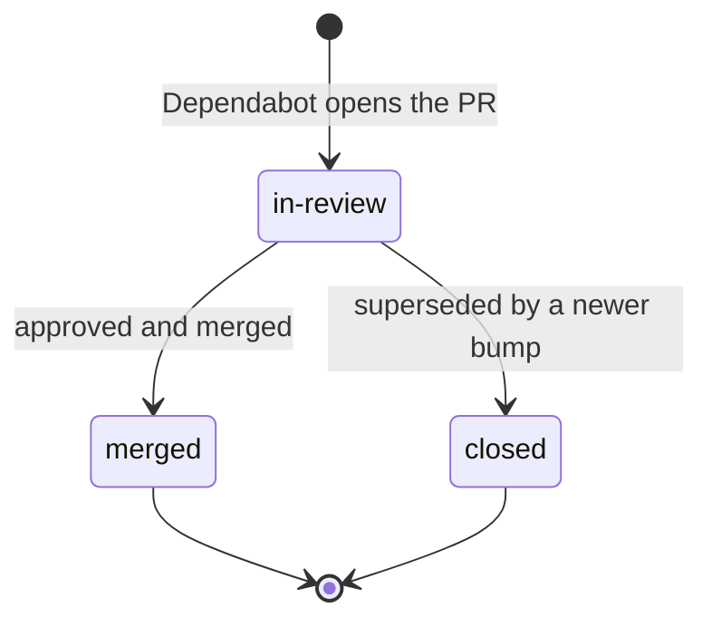

# OCT status workflow

Every issue and pull request in this repository carries its workflow state in three places:

- **Labels** for filtering: exactly one `phase:*`, zero or more `wait:*` (orange: something blocks), and a
  `resolution:*` on artifacts closed without a fix.
- **The status block** at the top of the description (for Dependabot pull requests: at the top of the guide
  comment), between `<!-- oct-status:v1 hash=... -->` and
  `<!-- /oct-status -->`: badges, root blocker, stack chain, automation row, who has the ball and the
  relations table.
- **The guide comment**, one bot comment per artifact marked `<!-- oct-next:v1 -->`, edited in place: last
  action, where you are, the next steps with ready-to-run `/oct` commands, the commands valid now, notices
  and a machine-readable data block.

The automation lives in `scripts/oct_status/` and runs in the workflow `.github/workflows/oct-status.yml`.
The design is `docs/superpowers/specs/2026-10-29-oct-status-system-design.md`; where this handbook and the
code differ, the code wins and this handbook is the bug.

**Rollout state.** The workflow runs in shadow mode: it computes everything and writes only the job summary.
Labels, blocks, guide comments and the commit status `oct-status` are written once a maintainer sets the
repository variable `OCT_STATUS_WRITE` to `true`. Strikes are off until `strikes_enabled_from` is set in
`scripts/oct_status/config.yml` (today it is `null`, so every notice stays at ladder level 1). The commit
status `oct-status` is not a required check yet. Discussions are not handled yet.

## Contents

- [Lifecycles](#lifecycles)
- [Reference](#reference): [kinds](#kinds), [phases](#phases), [waits](#waits),
  [resolutions](#resolutions), [labels](#labels)
- [Command reference](#command-reference)
- [You are up when...](#you-are-up-when)
- [Onboarding checklist for new maintainers](#onboarding-checklist-for-new-maintainers)
- [Walkthrough](#walkthrough): spec #537 with #573 / #574 on the #560 stack, bug #575, Dependabot #498
- [Violations](#violations): [V01](#v01-pull-request-without-a-spec) to
  [V08](#v08-closed-without-hardware-verification) and the escalation ladder
- [The gate: commit status oct-status](#the-gate-commit-status-oct-status)
- [Agents and subagents](#agents-and-subagents)
- [Troubleshooting](#troubleshooting)
- [Rollback runbook](#rollback-runbook)

## Lifecycles

Transitions named with a `/oct` command (or a label) are declarations; all other transitions are facts the
automation derives from GitHub (linked pull requests, reviews, checks, open or closed).

**Spec** (label `spec`, wins over `bug` and `enhancement`). A pull request references its spec with
`Part of #n` or `Closes #n`.



Pull requests for a spec that is not `ready` do not move the spec (they get `wait:prerequisite` and
violation V06). An open spec whose known parts are all merged stays `in-progress` (more parts may follow)
unless a hardware test is pending; it becomes `done` when it is closed.

**Bug and support issue** (label `bug` or `support`, no `spec`) and **feature request** (`enhancement` or no
kind label at all):



A linked pull request advances a bug or feature request from any phase, also from `new`. A feature request
that a spec references (edge `specified-by`) mirrors the least advanced open spec; when every such spec is
closed without completion it shows `closed` with `resolution:superseded`.

**Tracking issue** (title starts with `[Tracking]`) and **test plan** (title starts with `[Test]`):



Closing a test plan that `verifies` a pull request or spec clears `wait:hardware-test` on its target.

**Pull request** (also docs / chore pull requests and pull requests by automation that touch protected paths):



A pull request in `in-review` without any `wait:*` label is mergeable. Waits a pull request can carry:
`maintainer`, `findings`, `ci`, `prerequisite`, `hardware-test` (also after the merge), plus the declared
waits.

**Dependency pull request** (opened by `dependabot[bot]`): the same states, but no spec is required, no
strikes are counted, and the block lives in the bot's guide comment because Dependabot rewrites the
description.



A Dependabot pull request still waits for an approval (`wait:maintainer`); because Dependabot is not a
maintainer, only an approving review by a person with write access counts, never `oct-support`. If it changes a protected
path (for example a GitHub Actions bump under `.github/workflows/`), it also needs `/oct accept-paths`, see
[waits](#waits).

## Reference

### Kinds

The first matching row wins.

| Kind | Detected by | Block |
|---|---|---|
| dependency PR | pull request by `dependabot[bot]` | light, in the guide comment |
| announcement | anything created by an account in the `automation` list of `config.yml` | none, nothing is written |
| tracking | title starts with `[Tracking]` | full, in the description |
| test plan | title starts with `[Test]` | full, in the description |
| docs / chore PR | pull request with a `/oct no-spec` by its author, or a title of type `docs`, `ci`, `chore`, `style` or `test` | full, spec optional |
| pull request | any other pull request | full, in the description |
| spec | label `spec` | full, in the description |
| bug / support | label `bug` or `support` | full, in the description |
| feature request | label `enhancement`, or no kind label | full, in the description |

An automation-authored pull request that has an automation push to a protected path is treated as a pull
request for good (labels, block, guide, gate), so the acknowledgement stays visible.

### Phases

Exactly one `phase:*` label. Facts are re-applied by the automation if someone changes them by hand
(violation V02); declarations are made with commands (or the label, which is validated).

#### new

Issue nobody has looked at yet. Fact. Next: a maintainer runs `/oct triage`.

#### draft

The starting phase of a spec (nothing declared yet) or a draft pull request. Fact: set by the automation only. Next for
a spec: complete the `## Definition of Ready` checklist, then `/oct review`. For a pull request: mark it
ready for review.

#### triaged

A bug or feature request a maintainer accepted with `/oct triage`. Declaration. Next for a bug:
`/oct confirm`; otherwise a pull request that links it.

#### spec-review

The spec is under review after `/oct review` by its author. Declaration. Next: the reviewer answers with
`/oct ready --reviewer <login>` or `/oct rework <reason>`.

#### spec-rework

The reviewer sent the spec back with `/oct rework <reason>`; `wait:spec-fix` is set. Declaration. Next: the
author fixes the spec and runs `/oct review` again (or the reviewer runs `/oct ready`).

#### confirmed

A bug a maintainer reproduced, `/oct confirm`. Declaration. Next: a pull request that links it. When that
pull request is closed unmerged, the bug falls back to `triaged`: `confirmed` is not restored.

#### ready

The spec passed its review (`/oct ready`). Declaration. Implementation may start: open a pull request with
`Part of #<spec>` or `Closes #<spec>`.

#### in-progress

An open linked pull request is a draft, or an open spec, bug or feature request whose known parts are all
merged (more parts may follow). Fact. Exception: on a `[Test]` plan the label is a declaration, set by hand to
mark the test as started (design 4.1: `new` -> `in-progress` -> `done`); it is not V02 there.

#### in-review

A pull request ready for review, or an issue with an open linked pull request ready for review. Fact. A pull
request here without any `wait:*` label is mergeable.

#### verification

All parts are merged (or the issue was closed as completed) but `wait:hardware-test` is set (an open `[Test]`
plan or `/oct needs-hardware-test`). Fact. Next: a maintainer tests on a device and runs `/oct verified <device or note>`, then closes.

#### done

Closed as completed with no hardware test pending (issues), or a tracking issue whose children are all
closed. Fact. An issue closed without a `resolution:*` label counts as done.

#### merged

A merged pull request. Fact.

#### closed

Closed without a fix: a pull request closed unmerged, or an issue closed with a `resolution:*` label. Fact.

#### open

Discussions only (not handled yet).

#### needs-spec

Discussions only (not handled yet).

#### specified

Discussions only (not handled yet).

#### answered

Discussions only (not handled yet).

### Waits

Zero or more `wait:*` labels, all orange. "No orange" means nothing blocks.

| Wait | Owner | Set when | How to resolve |
|---|---|---|---|
| `wait:maintainer` | fact | an open, non-draft pull request has no valid approval on its current head. For a pull request by a maintainer (role `maintain` or `admin`) only an approval by `oct-support` counts; for anybody else an approval by another person whose association is `OWNER`, `MEMBER` or `COLLABORATOR`. Approvals by Gitar, Sonar, code quality and other bots never count. | pull request by a maintainer: `/oct approve` requests the review by `oct-support`. Anybody else's pull request (including Dependabot): a maintainer approves the current head; the guide says so and offers no `/oct approve`. Any later push invalidates the approval, except pushes by `formatter-bot` on a branch of this repository. |
| `wait:findings` | fact | unresolved review threads, a latest review `CHANGES_REQUESTED` by `gitar-bot[bot]`, a failed `SonarCloud Code Analysis` or `Gitar` check, or an automation push to a protected path that no maintainer acknowledged | resolve the threads, fix the findings; for protected paths a maintainer reviews the files and runs `/oct accept-paths` |
| `wait:ci` | fact | a check in `gate_checks` (`CI Summary`, `SonarCloud Code Analysis`, `Gitar`) is pending, or `CI Summary` failed. Missing and `skipped` checks are neutral; a failed quality gate is a finding, not CI. | fix the failing check, or wait for pending ones |
| `wait:prerequisite` | fact | a stacked-on parent pull request or a `Depends on #n` target is still open, or the pull request implements a spec that is not `ready` | wait for the parent to merge; get the spec declared ready |
| `wait:hardware-test` | fact and declaration | a linked `[Test]` plan (edge `verifies`) is open; without a test plan, after `/oct needs-hardware-test` | close the test plan, or `/oct verified <device or note>`. Merging does not clear it. |
| `wait:spec-fix` | declaration | `/oct rework <reason>` | the author fixes the spec; `/oct review` or `/oct ready` removes it |
| `wait:reporter` | declaration | `/oct needs-info`, or the issue handler asks the reporter | remove the label once the reporter answered |
| `wait:designer` | declaration | `/oct designer <reason>` | remove the label once the design is there |

The protected paths are listed in `scripts/oct_status/config.yml` (`protected_paths`): `.github/workflows/**`,
`scripts/oct_status/**`, `.gitar/**`, `.claude/**` and `.gitignore`. A push counts as automation when its
commit author or committer is in the `automation` list, so pushes by Dependabot, `formatter-bot` and Gitar to
these paths all need a maintainer's `/oct accept-paths`, also on docs / no-spec pull requests. Human pushes
never do. A commit with more files than GitHub lists counts as touching a protected path.

### Resolutions

Only on closed artifacts; the automation removes `resolution:*` from open ones. Set the label by hand when
you close without a fix (declaration), or use `/oct supersede #n` on a closed artifact.

| Resolution | Meaning |
|---|---|
| `resolution:duplicate` | duplicate of another item |
| `resolution:wontfix` | will not be worked on |
| `resolution:invalid` | not valid |
| `resolution:not-reproducible` | could not be reproduced |
| `resolution:works-as-designed` | behaves as designed |
| `resolution:superseded` | superseded by another item |
| `resolution:abandoned` | abandoned by the author |

### Labels

Created by the label sync from `scripts/oct_status/labels.yml` (the legacy names in the last column are
renamed in place, so existing assignments are kept). The automation only ever touches `phase:`, `wait:` and
`resolution:` labels; foreign labels such as `gitar-approved`, `dependencies` or `kb-scanned` are left alone.

| Label | Color | Owner | Renamed from |
|---|---|---|---|
| `phase:new` | #cfe0fa | fact | |
| `phase:draft` | #cfe0fa | fact | |
| `phase:triaged` | #a8c5f3 | declaration | `accepted` |
| `phase:spec-review` | #a8c5f3 | declaration | |
| `phase:spec-rework` | #a8c5f3 | declaration | |
| `phase:confirmed` | #7ba3ec | declaration | |
| `phase:ready` | #5b8ee6 | declaration | |
| `phase:in-progress` | #3a73d8 | fact (declaration on a test plan) | `wip` |
| `phase:in-review` | #2a5cc0 | fact | |
| `phase:verification` | #1e4590 | fact | |
| `phase:done` | #1a7f37 | fact | |
| `phase:merged` | #1a7f37 | fact | |
| `phase:closed` | #6e7781 | fact | |
| `phase:open` | #cfe0fa | discussions | |
| `phase:needs-spec` | #a8c5f3 | discussions | |
| `phase:specified` | #5b8ee6 | discussions | |
| `phase:answered` | #1a7f37 | discussions | |
| `wait:maintainer` | #f2a33a | fact | |
| `wait:findings` | #f2a33a | fact | |
| `wait:ci` | #f2a33a | fact | |
| `wait:prerequisite` | #f2a33a | fact | `blocked` |
| `wait:hardware-test` | #f2a33a | fact and declaration | |
| `wait:spec-fix` | #f2a33a | declaration | |
| `wait:reporter` | #f2a33a | declaration | `needs-info` |
| `wait:designer` | #f2a33a | declaration | |
| `resolution:duplicate` | #c9d1d9 | declaration | `duplicate` |
| `resolution:wontfix` | #c9d1d9 | declaration | `wontfix` |
| `resolution:invalid` | #c9d1d9 | declaration | `invalid` |
| `resolution:not-reproducible` | #c9d1d9 | declaration | |
| `resolution:works-as-designed` | #c9d1d9 | declaration | |
| `resolution:superseded` | #c9d1d9 | declaration | |
| `resolution:abandoned` | #c9d1d9 | declaration | |
| `spec` | #8250df | type label (recolored) | |
| `enhancement` | #b8f0c6 | type label (recolored) | |

## Command reference

Write a command at the start of a line in a new comment on the artifact (not in a code block, a quote or an
HTML comment); only the first command of a comment counts and edited comments are ignored. Commands need
write access (`write`, `maintain` or `admin`); maintainer commands need `maintain` or `admin`. Automation
accounts cannot run commands.

The bot reacts with :eyes: when it picks the command up, then :+1: (accepted) or :-1: (rejected). A
rejection reason appears under "Notices" in the guide comment; an accepted command appears under "Last
action". **If a command comment shows no bot reaction, repeat it: GitHub keeps only one queued run per
concurrency group**, so a command that arrives while another run of the same artifact waits can be dropped.
In shadow mode no reactions and no guide comments are written.

| Command | Who | Valid when | Effect |
|---|---|---|---|
| `/oct review` | spec author (write) | spec in `draft` or `spec-rework`, Definition of Ready complete | `phase:spec-review`, removes `wait:spec-fix` |
| `/oct rework <reason>` | write | spec in `spec-review` | `phase:spec-rework` and `wait:spec-fix` |
| `/oct ready --reviewer <login or "independent-review">` | write | spec in `spec-review` or `spec-rework`, Definition of Ready complete; the reviewer differs from the author; the author may only use `independent-review` | `phase:ready`, removes `wait:spec-fix` |
| `/oct triage` | maintainer | bug or feature request in `new` | `phase:triaged` |
| `/oct confirm` | maintainer | bug in `triaged` | `phase:confirmed` |
| `/oct approve` | PR author or maintainer | open pull request | requests the review by `oct-support`; its approval clears `wait:maintainer` only when the pull request was authored by a maintainer, so the guide offers it only then |
| `/oct verified <device or note>` | maintainer | any time | removes `wait:hardware-test` (an open linked test plan sets it again) |
| `/oct needs-hardware-test [note]` | maintainer | any time | adds `wait:hardware-test` |
| `/oct needs-info [note]` | maintainer | any time | adds `wait:reporter` |
| `/oct designer <reason>` | maintainer | any time | adds `wait:designer` |
| `/oct no-spec <reason>` | PR author (write) | pull request | makes it a docs / chore pull request: no spec needed, V01 waived |
| `/oct supersede #n` | maintainer | closed artifact, `#n` is another artifact | adds `resolution:superseded` (the `superseded-by` edge is not written yet) |
| `/oct override <reason>` | maintainer | any time | resolves every open notice on the artifact (including blocking ones). Before strikes are active it is noted in the guide only; afterwards it is recorded in the ledger issue, and rejected if the ledger cannot be written. Maintainers may override their own violations. |
| `/oct accept-paths` | maintainer | open pull request whose guide lists automation pushes to protected paths | acknowledges them up to the head commit the guide listed; stored with login and time in the guide's data. A later push to a protected path needs a new acknowledgement. |

The arguments in angle brackets are mandatory, those in square brackets optional. `/oct review`, `/oct ready`
and the other declarations are checked against the state machine: a command that is not legal in the current
phase is rejected with the list of valid ones. A `/oct review` or `/oct ready` rejected because the Definition
of Ready is incomplete or the reviewer is the author is violation [V07](#v07-invalid-declaration).

## You are up when...

Filter links (they show results once write mode is on):

| You are up when | Who | Filter |
|---|---|---|
| a pull request waits for the maintainer approval | maintainers | [`label:wait:maintainer`](https://github.com/opencloudtouch/opencloudtouch/pulls?q=is%3Aopen+label%3Await%3Amaintainer) |
| a new issue waits for triage | maintainers | [`label:phase:new`](https://github.com/opencloudtouch/opencloudtouch/issues?q=is%3Aissue+is%3Aopen+label%3Aphase%3Anew) |
| something needs a test on a real device | maintainers | [issues](https://github.com/opencloudtouch/opencloudtouch/issues?q=is%3Aissue+is%3Aopen+label%3Await%3Ahardware-test), [pull requests](https://github.com/opencloudtouch/opencloudtouch/pulls?q=label%3Await%3Ahardware-test) |
| a spec waits for its review | reviewers | [`label:phase:spec-review`](https://github.com/opencloudtouch/opencloudtouch/issues?q=is%3Aissue+is%3Aopen+label%3Aphase%3Aspec-review) |
| your spec came back from review | spec authors | [`label:wait:spec-fix author:@me`](https://github.com/opencloudtouch/opencloudtouch/issues?q=is%3Aissue+is%3Aopen+label%3Await%3Aspec-fix+author%3A%40me) |
| your pull request has open findings | PR authors | [`label:wait:findings author:@me`](https://github.com/opencloudtouch/opencloudtouch/pulls?q=is%3Aopen+label%3Await%3Afindings+author%3A%40me) |
| your pull request has failing or pending checks | PR authors | [`label:wait:ci author:@me`](https://github.com/opencloudtouch/opencloudtouch/pulls?q=is%3Aopen+label%3Await%3Aci+author%3A%40me) |
| your pull request waits on a prerequisite | PR authors | [`label:wait:prerequisite author:@me`](https://github.com/opencloudtouch/opencloudtouch/pulls?q=is%3Aopen+label%3Await%3Aprerequisite+author%3A%40me) |
| your issue waits for your answer | reporters | [`label:wait:reporter author:@me`](https://github.com/opencloudtouch/opencloudtouch/issues?q=is%3Aissue+is%3Aopen+label%3Await%3Areporter+author%3A%40me) |
| a design is needed | designer | [`label:wait:designer`](https://github.com/opencloudtouch/opencloudtouch/issues?q=is%3Aopen+label%3Await%3Adesigner) |

`wait:prerequisite` usually means you only wait: the guide comment names the blocking artifacts. The
"Ball with" line of the block says who has to act.

## Onboarding checklist for new maintainers

- [ ] Read [Lifecycles](#lifecycles) and the [Walkthrough](#walkthrough).
- [ ] Check your role: maintainer commands need `maintain` or `admin` on the repository.
- [ ] Bookmark the filters in [You are up when...](#you-are-up-when), at least `wait:maintainer`,
      `phase:new` and `wait:hardware-test`.
- [ ] Know the bots: `oct-support` approves maintainer pull requests after its AI review; Gitar, Sonar and
      code quality bots only report findings; `formatter-bot`, Gitar and Dependabot can push.
- [ ] Never set or remove fact labels by hand ([V02](#v02-fact-label-changed-by-hand)); use the commands.
- [ ] Before `/oct accept-paths`, read every listed file change of the automation push.
- [ ] Know where strikes are counted: the locked issue "oct-status ledger" (once strikes are active).
- [ ] Know how to stop the system: [Rollback runbook](#rollback-runbook).

## Walkthrough

Real artifacts, rendered from the frozen fixtures in `scripts/oct_status/tests/fixtures/` by
`scripts/oct_status/tools/render_doc_snippets.py`; a test compares every snippet with the renderer, so this
section cannot drift from the code. The fixtures were captured on 2026-10-29. Their descriptions were
sanitized to the reference lines (`Part of #n`, `Depends on #n`, bare `#n`), so no checklists appear; #570 to
#572 were not recorded, only their branches, titles and draft state are used. The collaborator permission
was not recorded either; the maintainer's login is rendered with the role `admin`. #535 and #261 are not part of
the fixtures, so the tables show `-` for them. The system was not live on these dates: each step shows what it
computes for that state. Steps marked **projection** apply one stated change to the recorded state.

### 2026-10-12: Dependabot pull request #498

`chore(deps-dev): bump joi from 18.2.8 to 18.2.9`, opened and merged the same day. Dependabot regenerates its
description, so the light block is the first part of the bot's guide comment:

<!-- snippet:498-pinned -->
```markdown
<!-- oct-status:v1 hash=b03777aabc80 -->


**State:** merged
<!-- /oct-status -->

<!-- oct-next:v1 -->

### Last action

-

### You are here

Phase **merged**, waiting on: nothing. [Workflow guide](https://github.com/opencloudtouch/opencloudtouch/blob/main/docs/WORKFLOW.md#merged)

### Next steps

Nothing to do.

### Commands valid now

None.

### Notices

None.

### History

<details>
<summary>Last five actions</summary>

-

</details>

<!-- oct-next-data {"next": [], "phase": "merged", "waits": []} -->
```
<!-- /snippet -->

<!-- snippet:498-labels -->
Labels: `dependencies`, `phase:merged`
<!-- /snippet -->

`dependencies` is a foreign label and stays. **Projection: #498 before its merge.** While open, a Dependabot
pull request shows `phase:in-review` and `wait:maintainer` until a person with write access approves its head:
Dependabot is not a maintainer, so an approval by `oct-support` does not count and the guide offers no
`/oct approve`:

<!-- snippet:498-open-pinned -->
```markdown
<!-- oct-status:v1 hash=f9a183a98441 -->
 

**State:** open
<!-- /oct-status -->

<!-- oct-next:v1 -->

### Last action

-

### You are here

Phase **in-review**, waiting on: maintainer. [Workflow guide](https://github.com/opencloudtouch/opencloudtouch/blob/main/docs/WORKFLOW.md#in-review)

### Next steps

1. **maintainer**: A maintainer approves the current head: an approving review by a person other than the author with the association OWNER, MEMBER or COLLABORATOR clears wait:maintainer; approvals by oct-support and other bots do not count on this pull request

### Commands valid now

None.

### Notices

None.

### History

<details>
<summary>Last five actions</summary>

-

</details>

<!-- oct-next-data {"next": [{"actor": "maintainer", "command": null, "text": "A maintainer approves the current head: an approving review by a person other than the author with the association OWNER, MEMBER or COLLABORATOR clears wait:maintainer; approvals by oct-support and other bots do not count on this pull request"}], "phase": "in-review", "waits": ["maintainer"]} -->
```
<!-- /snippet -->

<!-- snippet:498-open-labels -->
Labels: `dependencies`, `phase:in-review`, `wait:maintainer`
<!-- /snippet -->
 Dependabot pull requests never get strikes and need no spec. A GitHub
Actions bump (a change under `.github/workflows/`) additionally gets `wait:findings` until a maintainer runs
`/oct accept-paths`.

### 2026-10-24: spec #537 is filed

`[Spec]: Sleep timer` by the maintainer. It was filed before the issue form had a Definition of Ready, so its
description has no `## Definition of Ready` section: it is a legacy spec and stays in `draft`.

<!-- snippet:537-block -->
```markdown
<!-- oct-status:v1 hash=0b40567acf8a -->
 

**Root blocker:** #535

**Ball with:** author

| Relation | Artifact | Phase | Waiting on |
|---|---|---|---|
| implemented-by | #573 feat(sleep-timer): add per-device sleep timer with fade out | draft | prerequisite |
| implemented-by | #574 feat(frontend): add sleep timer to the local control page | draft | prerequisite |
| depends-on | #535 | - | - |
<!-- /oct-status -->
```
<!-- /snippet -->

<!-- snippet:537-labels -->
Labels: `enhancement`, `phase:draft`, `spec`
<!-- /snippet -->

<!-- snippet:537-guide -->
```markdown
<!-- oct-next:v1 -->

### Last action

-

### You are here

Phase **draft**, waiting on: nothing. [Workflow guide](https://github.com/opencloudtouch/opencloudtouch/blob/main/docs/WORKFLOW.md#draft)

### Next steps

1. **author**: Before /oct review, complete the Definition of Ready. Open: Definition of Ready section missing

### Commands valid now

- `/oct review`

### Notices

None.

### History

<details>
<summary>Last five actions</summary>

-

</details>

<!-- oct-next-data {"next": [{"actor": "author", "command": null, "text": "Before /oct review, complete the Definition of Ready. Open: Definition of Ready section missing"}], "phase": "draft", "waits": []} -->
```
<!-- /snippet -->

`Parts 0/2` counts the pull requests that implement the spec (#573 and #574). The root blocker #535 comes from
`Depends on #535`.

### 2026-10-25: #560 opens the stack

#560 (`feat(api): add machine-readable code to API error responses ...`) is ready for review on `main`.
Five draft pull requests are stacked on it: #570 on #560's branch, #571 on #570, #572 on #571, #573 on #572,
#574 on #573. Without an approval on its head the ball is with the maintainers:

<!-- snippet:560-block -->
```markdown
<!-- oct-status:v1 hash=1374724be6c3 -->
 

**Root blocker:** none

**Stack:** `main` > #560 (this PR) > #570 > #571 > #572 > #573 > #574

**Automation:** Gitar: success | Sonar: success | oct-support: none

**Ball with:** maintainers

| Relation | Artifact | Phase | Waiting on |
|---|---|---|---|
| implements | #535 | - | - |
| stacked-by | #570 feat(devices): add device settings API for language, clock and power saving | draft | prerequisite |
<!-- /oct-status -->
```
<!-- /snippet -->

<!-- snippet:560-labels -->
Labels: `phase:in-review`, `wait:maintainer`
<!-- /snippet -->

<!-- snippet:560-guide -->
````markdown
<!-- oct-next:v1 -->

### Last action

-

### You are here

Phase **in-review**, waiting on: maintainer. [Workflow guide](https://github.com/opencloudtouch/opencloudtouch/blob/main/docs/WORKFLOW.md#in-review)

### Next steps

1. **author**: Request the review by oct-support; its approval clears wait:maintainer
   ```
   /oct approve
   ```

### Commands valid now

- `/oct approve`

### Notices

None.

### History

<details>
<summary>Last five actions</summary>

-

</details>

<!-- oct-next-data {"next": [{"actor": "author", "command": "/oct approve", "text": "Request the review by oct-support; its approval clears wait:maintainer"}], "phase": "in-review", "waits": ["maintainer"]} -->
````
<!-- /snippet -->

### 2026-10-26: #573 and #574 implement the spec

Both are drafts with `Part of #537`. They wait on their stack parent, and #537 is not `ready`, so the guide
of #573 carries a [V06](#v06-pull-request-for-a-spec-that-is-not-ready) notice (level 1: strikes are not
active):

<!-- snippet:573-block -->
```markdown
<!-- oct-status:v1 hash=ada87093266c -->
 

**Root blocker:** #560 feat(api): add machine-readable code to API error responses and typed ApiError in the frontend

**Stack:** `main` > #560 > #570 > #571 > #572 > #573 (this PR) > #574

**Automation:** Gitar: success | Sonar: success | oct-support: none

**Ball with:** author

| Relation | Artifact | Phase | Waiting on |
|---|---|---|---|
| implements | #537 [Spec]: Sleep timer — fade out and stop a SoundTouch device after a countdown | draft | - |
| stacked-on | #572 feat(frontend): add stream recovery section to the settings page | draft | prerequisite |
| stacked-by | #574 feat(frontend): add sleep timer to the local control page | draft | prerequisite |
<!-- /oct-status -->
```
<!-- /snippet -->

<!-- snippet:573-labels -->
Labels: `phase:draft`, `wait:prerequisite`
<!-- /snippet -->

<!-- snippet:573-guide -->
```markdown
<!-- oct-next:v1 -->

### Last action

-

### You are here

Phase **draft**, waiting on: prerequisite. [Workflow guide](https://github.com/opencloudtouch/opencloudtouch/blob/main/docs/WORKFLOW.md#draft)

### Next steps

1. **author**: Wait for #572 to be merged or done

### Commands valid now

None.

### Notices

- [V06](https://github.com/opencloudtouch/opencloudtouch/blob/main/docs/WORKFLOW.md#v06-pull-request-for-a-spec-that-is-not-ready) pull request for a spec that is not ready. Spec #537 is not ready yet. Expected: Implementation starts after the spec is ready. Next steps: Complete the Definition of Ready of the spec and have it reviewed. `/oct review`

### History

<details>
<summary>Last five actions</summary>

-

</details>

<!-- oct-next-data {"next": [{"actor": "author", "command": null, "text": "Wait for #572 to be merged or done"}], "notices": [{"artifact": 573, "hint": "Spec #537 is not ready yet.", "key": "", "level": 1, "resolved": "", "rule": "V06", "ts": "2026-10-26T00:58:00+00:00", "user": "scheilch"}], "phase": "draft", "waits": ["prerequisite"]} -->
```
<!-- /snippet -->

The notice is stored in the `oct-next-data` block, so it survives later runs until it is resolved. #574 shows
the same picture one step further down the stack:

<!-- snippet:574-block -->
```markdown
<!-- oct-status:v1 hash=8e3b17e8d07e -->
 

**Root blocker:** #560 feat(api): add machine-readable code to API error responses and typed ApiError in the frontend

**Stack:** `main` > #560 > #570 > #571 > #572 > #573 > #574 (this PR)

**Automation:** Gitar: success | Sonar: success | oct-support: none

**Ball with:** author

| Relation | Artifact | Phase | Waiting on |
|---|---|---|---|
| implements | #537 [Spec]: Sleep timer — fade out and stop a SoundTouch device after a countdown | draft | - |
| stacked-on | #573 feat(sleep-timer): add per-device sleep timer with fade out | draft | prerequisite |
<!-- /oct-status -->
```
<!-- /snippet -->

<!-- snippet:574-labels -->
Labels: `phase:draft`, `wait:prerequisite`
<!-- /snippet -->

### Projection: the backfill declares #537 ready

The backfill (maintainer action MA-6) declares a legacy spec that already has pull requests `phase:ready`,
written by the bot. The spec then follows its parts (`in-progress`, the parts are drafts), and the V06 notice
on #573 resolves on the next run:

<!-- snippet:537-backfilled-block -->
```markdown
<!-- oct-status:v1 hash=d76da4a02c1c -->
 

**Root blocker:** #535

**Ball with:** nobody

| Relation | Artifact | Phase | Waiting on |
|---|---|---|---|
| implemented-by | #573 feat(sleep-timer): add per-device sleep timer with fade out | draft | prerequisite |
| implemented-by | #574 feat(frontend): add sleep timer to the local control page | draft | prerequisite |
| depends-on | #535 | - | - |
<!-- /oct-status -->
```
<!-- /snippet -->

<!-- snippet:537-backfilled-labels -->
Labels: `enhancement`, `phase:in-progress`, `spec`
<!-- /snippet -->

<!-- snippet:573-backfilled-guide -->
```markdown
<!-- oct-next:v1 -->

### Last action

-

### You are here

Phase **draft**, waiting on: prerequisite. [Workflow guide](https://github.com/opencloudtouch/opencloudtouch/blob/main/docs/WORKFLOW.md#draft)

### Next steps

1. **author**: Wait for #572 to be merged or done

### Commands valid now

None.

### Notices

None.

<details>
<summary>Resolved notices (1)</summary>

- [V06](https://github.com/opencloudtouch/opencloudtouch/blob/main/docs/WORKFLOW.md#v06-pull-request-for-a-spec-that-is-not-ready) pull request for a spec that is not ready: fixed.

</details>

### History

<details>
<summary>Last five actions</summary>

-

</details>

<!-- oct-next-data {"next": [{"actor": "author", "command": null, "text": "Wait for #572 to be merged or done"}], "notices": [{"artifact": 573, "hint": "Spec #537 is not ready yet.", "key": "", "level": 1, "resolved": "fixed", "rule": "V06", "ts": "2026-10-26T00:58:00+00:00", "user": "scheilch"}], "phase": "draft", "waits": ["prerequisite"]} -->
```
<!-- /snippet -->

### 2026-10-26: bug #575 is filed

`[Bug]: SoundTouch 30 - SSH access fails after USB remote_services method`, by an external reporter:

<!-- snippet:575-block -->
```markdown
<!-- oct-status:v1 hash=024c29e73de3 -->


**Root blocker:** none

**Ball with:** maintainers
<!-- /oct-status -->
```
<!-- /snippet -->

<!-- snippet:575-labels -->
Labels: `bug`, `phase:new`
<!-- /snippet -->

<!-- snippet:575-guide -->
````markdown
<!-- oct-next:v1 -->

### Last action

-

### You are here

Phase **new**, waiting on: nothing. [Workflow guide](https://github.com/opencloudtouch/opencloudtouch/blob/main/docs/WORKFLOW.md#new)

### Next steps

1. **maintainer**: Record the decision: triage
   ```
   /oct triage
   ```

### Commands valid now

- `/oct triage`

### Notices

None.

### History

<details>
<summary>Last five actions</summary>

-

</details>

<!-- oct-next-data {"next": [{"actor": "maintainer", "command": "/oct triage", "text": "Record the decision: triage"}], "phase": "new", "waits": []} -->
````
<!-- /snippet -->

### Projection: a maintainer triages #575

A maintainer comments `/oct triage`. The bot reacts, sets the declaration and rewrites the guide (the phase
badge of the block changes to `triaged` as well):

<!-- snippet:575-triaged-labels -->
Labels: `bug`, `phase:triaged`
<!-- /snippet -->

<!-- snippet:575-triaged-guide -->
````markdown
<!-- oct-next:v1 -->

### Last action

/oct triage by a-maintainer: marked triaged

### You are here

Phase **triaged**, waiting on: nothing. [Workflow guide](https://github.com/opencloudtouch/opencloudtouch/blob/main/docs/WORKFLOW.md#triaged)

### Next steps

1. **maintainer**: Record the decision: confirm
   ```
   /oct confirm
   ```

### Commands valid now

- `/oct confirm`

### Notices

None.

### History

<details>
<summary>Last five actions</summary>

- /oct triage by a-maintainer: marked triaged

</details>

<!-- oct-next-data {"next": [{"actor": "maintainer", "command": "/oct confirm", "text": "Record the decision: confirm"}], "phase": "triaged", "waits": []} -->
````
<!-- /snippet -->

### Projection: oct-support approves #560

The author of #560 is the maintainer (role `maintain` or `admin`), so only an approval by `oct-support` on the
current head clears `wait:maintainer`. With no wait left, #560 in `in-review` is mergeable:

<!-- snippet:560-approved-block -->
```markdown
<!-- oct-status:v1 hash=678a8986dbb2 -->


**Root blocker:** none

**Stack:** `main` > #560 (this PR) > #570 > #571 > #572 > #573 > #574

**Automation:** Gitar: success | Sonar: success | oct-support: approved

**Ball with:** maintainers

| Relation | Artifact | Phase | Waiting on |
|---|---|---|---|
| implements | #535 | - | - |
| stacked-by | #570 feat(devices): add device settings API for language, clock and power saving | draft | prerequisite |
<!-- /oct-status -->
```
<!-- /snippet -->

<!-- snippet:560-approved-labels -->
Labels: `phase:in-review`
<!-- /snippet -->

### Projection: #560 is merged

After the squash merge GitHub retargets #570 onto `main`. Merged parents drop out of the chain, and the root
blocker of #573 moves to #570:

<!-- snippet:573-after-560-merged-block -->
```markdown
<!-- oct-status:v1 hash=b50fa2022275 -->
 

**Root blocker:** #570 feat(devices): add device settings API for language, clock and power saving

**Stack:** `main` > #570 > #571 > #572 > #573 (this PR) > #574

**Automation:** Gitar: success | Sonar: success | oct-support: none

**Ball with:** author

| Relation | Artifact | Phase | Waiting on |
|---|---|---|---|
| implements | #537 [Spec]: Sleep timer — fade out and stop a SoundTouch device after a countdown | draft | - |
| stacked-on | #572 feat(frontend): add stream recovery section to the settings page | draft | prerequisite |
| stacked-by | #574 feat(frontend): add sleep timer to the local control page | draft | prerequisite |
<!-- /oct-status -->
```
<!-- /snippet -->

## Violations

A violation is a breach of a workflow rule by a person; the automation reports it as a notice in the guide
comment (never as a new comment), with what happened, what was expected, the next steps and a link here.
Automation accounts and first-time contributors on fork pull requests are exempt. V01, V04 and V06 describe
the state of an open pull request and are charged to its author; they are re-checked on every event of that
pull request. V02, V03, V05, V07 and V08 describe one change and are charged to the person who made it.

**Escalation ladder.** Counted per user over a rolling 60 days in the locked issue "oct-status ledger",
de-duplicated per artifact and rule:

1. First violation: a notice with what happened, what was expected and the next steps. The check stays
   green.
2. Second: the same, plus the hint that a maintainer can `/oct override REASON`.
3. Third and later: on a pull request the commit status `oct-status` fails until the violation is fixed or
   overridden. On an issue the automation reverts a hand-set fact label (V02) and says so; a hand-edited
   block (V03) is restored anyway. V05 and V08 on issues are not reverted: the notice stays until the
   change is undone.

**Inactive until activation:** while `strikes_enabled_from` in `scripts/oct_status/config.yml` is unset (the
case today), nothing is recorded and every notice stays at level 1. The ladder as rendered for #573:

<!-- snippet:ladder -->
```markdown
Level 1: [V06](https://github.com/opencloudtouch/opencloudtouch/blob/main/docs/WORKFLOW.md#v06-pull-request-for-a-spec-that-is-not-ready) pull request for a spec that is not ready. Spec #537 is not ready yet. Expected: Implementation starts after the spec is ready. Next steps: Complete the Definition of Ready of the spec and have it reviewed. `/oct review`

Level 2: [V06](https://github.com/opencloudtouch/opencloudtouch/blob/main/docs/WORKFLOW.md#v06-pull-request-for-a-spec-that-is-not-ready) pull request for a spec that is not ready. Spec #537 is not ready yet. Expected: Implementation starts after the spec is ready. Next steps: Complete the Definition of Ready of the spec and have it reviewed. `/oct review` A maintainer can override this with `/oct override REASON`.

Level 3: [V06](https://github.com/opencloudtouch/opencloudtouch/blob/main/docs/WORKFLOW.md#v06-pull-request-for-a-spec-that-is-not-ready) pull request for a spec that is not ready. Spec #537 is not ready yet. Expected: Implementation starts after the spec is ready. Next steps: Complete the Definition of Ready of the spec and have it reviewed. `/oct review` A maintainer can override this with `/oct override REASON`. The check oct-status fails on this pull request until this is fixed or overridden.

Level 3 on an issue: [V02](https://github.com/opencloudtouch/opencloudtouch/blob/main/docs/WORKFLOW.md#v02-fact-label-changed-by-hand) fact label changed by hand. The label `phase:in-progress` was added by hand. Expected: Phase and wait labels that describe facts are written by the status automation only. Next steps: Leave the label to the automation; it restores the derived value. `/oct triage` A maintainer can override this with `/oct override REASON`. The offending change is reverted.
```
<!-- /snippet -->

An open notice resolves on its own once the cause is gone (see each rule) or after a maintainer's
`/oct override`; resolved notices fold into "Resolved notices".

### V01: Pull request without a spec

**What happened:** an open pull request has no `Part of #n` or `Closes #n` to a spec and no `/oct no-spec`.
Pull requests titled `docs:`, `ci:`, `chore:`, `style:` or `test:` and Dependabot are exempt.

**Expected:** every pull request names the spec it implements, or states why none is needed.

**Next steps:** add `Part of #<spec>` or `Closes #<spec>` to the description, or comment
`/oct no-spec <reason>`. The notice resolves when the pull request no longer breaks the rule.

**Wrong:** a pull request `feat(player): add crossfade` whose description says "see the discussion".

**Right:** the same pull request with `Part of #537` in its description, or the comment
`/oct no-spec typo fix in an error message`.

### V02: Fact label changed by hand

**What happened:** a person added or removed a fact label: `phase:new`, `draft`, `in-progress`, `in-review`,
`merged`, `done`, `closed`, `verification`, or `wait:maintainer`, `findings`, `ci`, `prerequisite`,
`hardware-test`.

**Expected:** phase and wait labels that describe facts are written by the automation only.

**Next steps:** leave the label alone; the automation restores the derived value. Use the command for what
you meant (for example `/oct triage`, `/oct needs-hardware-test`, `/oct verified`).

**Wrong:** removing `wait:maintainer` from a pull request so it looks mergeable.

**Right:** on your own pull request as a maintainer `/oct approve`, then wait for the approval by
`oct-support`; on anybody else's pull request a maintainer reviews and approves the current head.

On a pull request at level 3 the label is healed in the same run, but the notice resolves only on the next
event of that pull request: the commit status `oct-status` stays red until the next event or a maintainer's
`/oct override`. Not a V02: `phase:in-progress` on a `[Test]` plan, which is that plan's declaration.

### V03: Status block edited by hand

**What happened:** the description was edited and the status block was removed, or its content no longer
matches the hash in its marker.

**Expected:** the block between `<!-- oct-status:v1 ... -->` and `<!-- /oct-status -->` is written by the
automation only.

**Next steps:** edit only outside the markers; the automation restores the block.

**Wrong:** editing the description in the web UI and deleting the block together with an old paragraph.

**Right:** editing the text below `<!-- /oct-status -->` and leaving the block untouched.

### V04: Ready pull request with an open prerequisite

**What happened:** a pull request is ready for review although an artifact it `Depends on` is still open and
the pull request is not stacked on it.

**Expected:** a pull request is marked ready only when its prerequisites are merged or it is stacked on them.

**Next steps:** retarget the pull request onto its prerequisite's branch, or convert it back to a draft until
the prerequisite is merged.

**Wrong:** `Depends on #560` in a pull request based on `main` and ready for review while #560 is open.

**Right:** the pull request based on #560's branch (as #570 is), or kept as a draft until #560 is merged.

### V05: Template section or checklist item deleted

**What happened:** an edit of a pull request or spec removed a heading or a checklist item of the template
(the text before a colon identifies an item, so filling it in is fine).

**Expected:** template sections and Definition of Ready / Done items stay; items that do not apply are
marked `n/a` with a reason.

**Next steps:** restore the section or item and write `n/a` plus the reason if it does not apply.

**Wrong:** deleting `- [ ] Migrations in the reserved range and upgrade path tested (if the DB changed)` from
the Definition of Done of a pull request without a database change.

**Right:** keeping the item and filling it in:
`- [x] Migrations in the reserved range and upgrade path tested (if the DB changed): n/a, no database change`.

### V06: Pull request for a spec that is not ready

**What happened:** an open pull request implements a spec that is not `ready` yet.

**Expected:** implementation starts after the spec is ready.

**Next steps:** complete the spec's Definition of Ready, have it reviewed (`/oct review`, then the reviewer's
`/oct ready --reviewer <login>`). The pull request keeps `wait:prerequisite` meanwhile.

**Wrong:** #573 and #574 with `Part of #537` while #537 is in `draft` (see the
[walkthrough](#2026-10-26-573-and-574-implement-the-spec)).

**Right:** opening the pull requests after #537 shows `phase:ready`.

### V07: Invalid declaration

**What happened:** a `/oct review` or `/oct ready` was rejected because a precondition failed: the Definition
of Ready is incomplete, or the reviewer is the author.

**Expected:** a declaration is made when its preconditions hold.

**Next steps:** fix what the notice names, then repeat the command. The notice resolves when the same
declaration is accepted.

**Wrong:** `/oct ready --reviewer <the author's login>`, or `/oct review` with unticked Definition of Ready
items.

**Right:** tick (or mark `n/a` with a reason) every Definition of Ready item, then `/oct review`; the
reviewer answers `/oct ready --reviewer <own login>`, or the author uses
`/oct ready --reviewer independent-review` after an independent review.

### V08: Closed without hardware verification

**What happened:** an issue in `verification` was closed as completed by a person (not by a merge) while the
hardware test is still open.

**Expected:** an artifact in verification is closed after `/oct verified`.

**Next steps:** reopen the issue, verify on a device, then `/oct verified <device or note>` and close it. The
notice resolves when the issue is reopened or no longer in verification.

**Wrong:** closing a bug in `verification` with "should work now".

**Right:** `/oct verified SoundTouch 30, firmware 27.0.6` and then closing the issue.

## The gate: commit status oct-status

In write mode the job `status-write` posts the commit status `oct-status` on the head commit of every open
pull request a run touches; the daily audit (03:17 UTC) posts it for all open pull requests. This commit
status context is the one to make required (planned for the enforcement step); the workflow job also named
`oct-status` only reports. The status fails, with the first reason as description, when:

- the status block is missing or out of date,
- automation pushed to a protected path without a maintainer's `/oct accept-paths`,
- the guide comment could not be read (open violations cannot be ruled out),
- an open violation at ladder level 3 or higher sits on the pull request.

The status is written only in write mode, which is enabled by the repository variable `OCT_STATUS_WRITE`
(`true`). In shadow mode the job summary shows the same result and no status is posted.

## Agents and subagents

Enforced by hooks once Task 16 lands. Until then the same rules apply by convention: never write the status
block or fact labels, use `/oct` commands, start a pull request only for a `ready` spec with `Part of #n` or
`Closes #n` and the complete template, and read the guide comment's `oct-next-data` block for the next steps.

## Troubleshooting

**The block is missing or wrong.** It is restored on the next event of the artifact (an edit is an event) or
by the daily audit; editing it yourself is V03. In shadow mode nothing is written.

**A label came back after I changed it.** Fact labels are derived; use the matching command
([V02](#v02-fact-label-changed-by-hand)). Declarations need a legal transition: a `phase:ready` set by hand
on a spec without a complete Definition of Ready is ignored.

**`oct-status` is red.** Read the status description and the notices of the guide comment; see
[the gate](#the-gate-commit-status-oct-status). A red status after a V02 heals with the next event on the
pull request or a maintainer's `/oct override`.

**My command got no reaction.** Repeat it: GitHub keeps only one queued run per concurrency group, so a
command that arrived while another run waited can be dropped. Check also that it starts a line and is not
inside a code block or quote.

**My command got :-1:.** The reason is under "Notices" in the guide comment: missing access, not valid in
this phase (the valid commands are listed), or a failed precondition.

**The guide comment is corrupt** (the job summary warns that its data is missing, oversized or invalid, the
backfill reports `skipped (corrupt guide)`, and `oct-status` fails closed). Delete the guide comment: it is
rebuilt on the next run, but its persisted notices and the protected-path acknowledgements are lost, so a
maintainer may have to repeat `/oct accept-paths`.

**There are two guide comments.** The next run keeps the oldest and deletes the rest.

**A Dependabot pull request has no block in its description.** By design: its block is in the bot's guide
comment.

## Rollback runbook

1. If `oct-status` was made a required status check, remove it first (Settings, Branches, the rule for
   `main`), otherwise pull requests wait for a status nobody posts.
2. Set the repository variable `OCT_STATUS_WRITE` to `false` (or delete it). The workflow is back in shadow
   mode: no labels, blocks, guide comments, reactions or statuses are written.
3. To stop it completely, disable the workflow "OCT Status" under Actions.
4. To stop strikes only, set `strikes_enabled_from` back to `null` in `scripts/oct_status/config.yml`.

Labels, blocks and guide comments stay where they are and become inert; existing commit statuses stay on
their commits. No tool removes them: the backfill only writes. Remove blocks or guide comments by hand if
needed, and rename labels back in the label settings (the label sync has no reverse mode). The ledger issue
stays as the audit record.
